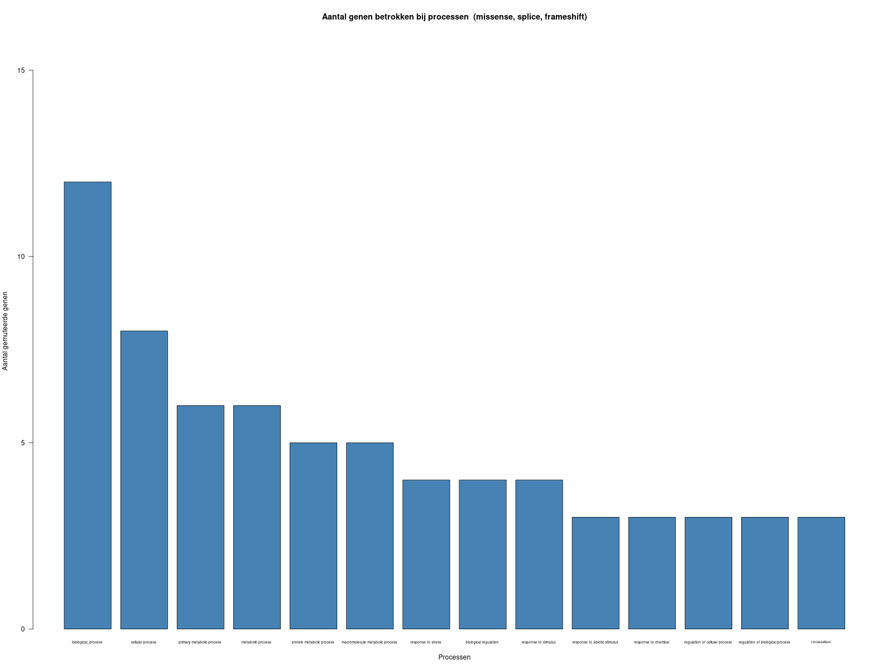
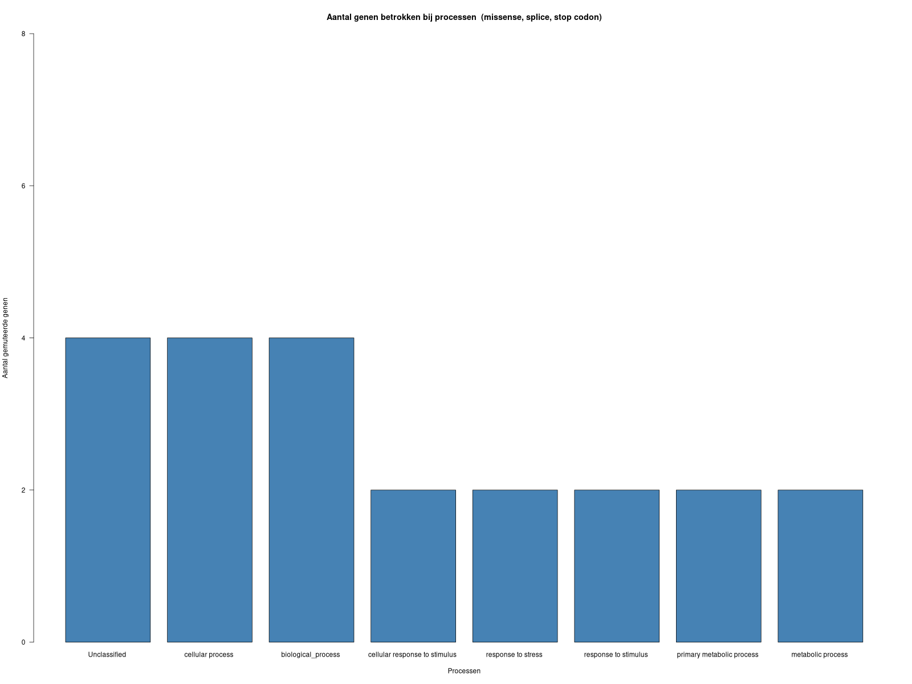

<<<<<<< HEAD
---
title: "Logboek"
author: "Tristan Kruithof"
date: "`r Sys.Date()`"
output:
  pdf_document: default
  word_document: default
  html_document:
    df_print: paged
header-includes:
- \usepackage{fvextra}
- \DefineVerbatimEnvironment{Highlighting}{Verbatim}{breaklines,commandchars=\\\{\}}
editor_options:
  markdown:
    wrap: 72
---

### Introductie

Door te kijken naar varianten die aanwezig zijn in de samples uit dit: https://pmc.ncbi.nlm.nih.gov/articles/PMC11449079/#koae226-B18 onderzoek, kunnen
we wat zeggen over de impact van deze varianten op bijvoorbeeld metabolic pathways
van deze plant. Dit gaan we doen door een vergelijkbare pipeline samen te stellen 
als in het onderzoek met ongeveer deze tools in een reeks: fastqc -> multiqc 
-> trimmomatic -> fastqc -> multiqc -> STAR -> samtools markdup 
-> samtools index -> bcftools -> analyse in R


### Motivatie

Genetische varianten in planten die zorgen dat planten 
eerder in ontwikkeling over gaan naar een reproductieve 
staat, kunnen bijvoorbeeld sneller fruit leveren of sneller
kruisen met elkaar zodat je sneller gewenste eigenschappen
kan combineren. 


### Onderzoeksvraag

Welke genetische varianten zijn aanwezig in de plant 
Arabidopsis thaliana die een grote invloed 
hebben op de desbetreffende genen?

### Deelvragen

Maken de genen met de varianten ook deel uit van belangrijke metabolic pathways?

Zijn deze metabolic pathways belangrijk voor de overgang van vegetatieve staat naar reproductieve staat? (non-bolting/bolting)

### Hoofddoel

Proberen varianten te vinden waar we met significantie wat over hun effect kunnen zeggen.


### Github Repo (zie voor meer info over het onderzoek en data)

https://github.com/DeBaarse/PlantAnalyse

### Waar kan ik de data vinden?

op de server assemblix onder:
/students/2026-2027/Thema05/plantanalysegroep2

#### En op de github repo:

https://github.com/DeBaarse/PlantAnalyse/tree/main/data


#### Waar kan ik andermans logboeken vinden?
https://github.com/DeBaarse/PlantAnalyse/tree/main/logboeken/tristan


# Logboek - genomics & transcriptomics

### 07/09/2026

#### Doel:

Informatie krijgen over het begin van de casus en een artikel zoeken waarbij genomics en transcriptomics voorkomt.
En we moeten een begin maken met ons plan van aanpak. 


#### Motivatie:

We moeten een artikel vinden waarbij beide voorkomt en die wij interessant vinden. 


#### Werkzaamheden:

Eerst hebben we geluisterd naar de uitleg van de casus en daarna zijn we bezig gegaan met een artikel zoeken op ncbi,
waarbij de volledige publicatie ook zichtbaar was. 

Hier hebben we de links van het artikel: 
https://pubmed.ncbi.nlm.nih.gov/39121073/
https://www.ncbi.nlm.nih.gov/geo/query/acc.cgi?acc=GSE242681

Het artikel gaat over de transcriptional events die plaatsvinden in de overgang van planten van not-bolting to bolting.
(not flowering and flowering).

En hier de link naar de dataset die ze hebben gebruikt.
https://www.ncbi.nlm.nih.gov/Traces/study/?acc=PRJNA1014093&o=acc_s%3Aa

Ook is er in teams een gedeeld document gemaakt voor de PVA (plan van aanpak).

https://hanzenl.sharepoint.com/:w:/r/teams/BrightspaceGenomicsTranscriptomicsTeam-Groep-2/Gedeelde%20documenten/PVA.docx?d=w4e1a9ac7982b4039b7dc71da3b7c5648&csf=1&web=1&e=f4dhAK

Ook hebben we een github aangemaakt:
https://github.com/DeBaarse/PlantAnalyse

Ik heb ook vervolgens al gelijk mijn logboek aangemaakt, zodat ik vanaf vandaag alles kan bijhouden.
En ik heb al een begin gemaakt met de planning in de pva.

#### Bestanden aangepast:

pva.docx (online)

#### Resultaten/stand van zaken:

We hebben vandaag eigenlijk alles gedaan wat we wilden doen. Dus dat is mooi. 

#### Conclusie en vervolgstappen:

Gedaan wat we moesten doen, maar we moeten nog veel doen aan het plan van aanpak, uitzoeken hoe we de data
moeten downloaden en waar. En welke onderzoeks vraag we moeten stellen als we het alleen over genomics hebben.
Ook moeten we het artikel grondig doorlezen. 


### 13/09/2026

#### Doel:

In de trein gemiste lesstof bekijken en het artikel over bolting plants overzichtelijk inlezen.

#### Conclusie en vervolgstappen:

Verkeerde les ingelezen, maar het artikel begrijp ik wel nu meer.


### 14/09/2026

#### Doel:

PVA afmaken, aan het logboek verder werken, PVA powerpoint maken, git clonen, voorbereidingen doen voor
het downloaden van onze data. Beter inlezen op het artikel. 

#### Motivatie:

We moeten nog enorm veel doen en uitzoeken voor ons project en lopen er een stuk achter mee. Dus we moeten 
flink bezig gaan zodat het ons nog lukt voor de presentatie morgen. Met de rest moeten we ook echt bezig gaan, want
we lopen nu al achter. 


#### Werkzaamheden:
Na alle uitleg over sequencing methodes ben ik begonnen met een ander project, waarbij je in galaxy moet werken.
Daarna ben ik begonnen met de PVA maken en de presentatie daarbij. We hadden hiervoor een document pva en een presentatie
genomics met deze links (zullen waarschijnlijk niet werken).
PVA
https://hanzenl.sharepoint.com/:w:/r/teams/BrightspaceGenomicsTranscriptomicsTeam-Groep-2/_layouts/15/Doc.aspx?action=edit&sourcedoc=%7B4e1a9ac7-982b-4039-b7dc-71da3b7c5648%7D&wdExp=TEAMS-TREATMENT&web=1
PP
https://hanzenl.sharepoint.com/:p:/r/teams/BrightspaceGenomicsTranscriptomicsTeam-Groep-2/_layouts/15/Doc.aspx?action=edit&sourcedoc=%7Bcd4f40ef-992e-4140-a2b5-2cfdcedf3fd4%7D&wdExp=TEAMS-TREATMENT&web=1
Ik heb voornamelijk als groepsgenoot andere mensen aangestuurd dingen te doen en suggesties gemaakt over hoe we het beter konden doen, veel is via whatsapp gecommuniceerd.
Zelf heb ik het deel gemaakt over de data van het orginele onderzoek en hoe we dat gaan gebruiken gemaakt. Ook heb ik de vervolgstappen en de referenties gemaakt. 

De locatie voor de data van het experiment dat we nog moeten downloaden heb ik aangemaakt op assemblix in een map onder students.
We gebruiken hiervoor de online rstudio van https://bioinf.nl/rstudio. Ook heb ik dit gepushed naar de repo op github.

Toen de presentatie grotendeels af was heb ik mij nog even verder verdiept op dingen uit het artikel dat ik nog niet volledige snapte, zoals de pseudotijd
met de planten. Ook had ik nog een scriptje van Ronald gekopieerd dat nodig is voor het downloaden van al onze samples op assemblix.


#### Bestanden aangepast:

genomics.pptx (online)
pva.docx (online)
github repo (online)


#### Resultaten/stand van zaken:

repo is aangepast, pva bijna af, script voor downloaden staat klaar, presentatie is af.
En ik heb mij verder verdiept in het artikel en vooral de dingen die nog onduidelijk voor mij waren. 


#### Conclusie en vervolgstappen:

Ik heb eigenlijk alles kunnen doen voor dit project wat ik had willen doen.
Maar een groepsgenoot is ziek, dus we moeten morgen bij de presentatie zijn deel van hem overnemen, dus dat nog maar even zien. 
We moeten ons ook nog beter verdiepen in de tools en welke we specifiek moeten gebruiken en hoe. 
En we willen morgen na de presentaties graag de data van het experiment op assemblix downloaden.


### 15/09/2026

#### Doel:
De presentatie over ons plan van aanpak presenteren. En de feedback daarvan verwerken.
Luisteren naar uitleg over de minIon, verder werken aan mij logboek en zorgen dat we de data 
eindelijk downloaden op het assemblix systeem, zodat we kunnen beginnen met een subset maken van onze data.


#### Motivatie:
We moeten vandaag presenteren. We moeten vandaag de data downloaden. We moeten vandaag luisteren naar uitleg.
En ik moet vandaag verder werken aan mijn logboek.


#### Werkzaamheden:
Eerst hadden we de presentaties, dat ging goed wat mij betreft. Waarbij we goed de keuzes van de tools en het doel van ons onderzoek konden uitleggen. Daarna heb ik de presentatie ingeleverd op brightspace, waarna we uitleg hadden over de minIon.

Ik had gister al een script klaar gezet op assemblix, maar ik moest hiervoor nog de onjuiste paths
vervangen met de juiste paths. Hier zie je dat script, daarna hebben we de download gestart.

```{bash SRA_download, eval=FALSE}
prefetch $(</homes/tjdkruithof/bin-jaar-2/blok-1-genomics-transcriptomics/PlantAnalyse/data/SRR_Acc_List.txt) --output-directory \
  /students/2026-2027/Thema05/plantanalysegroep2/SRA
```

```{bash extract_fastq, eval=FALSE}
find /students/2026-2027/Thema05/plantanalysegroep2/SRA -name "*.sra" | \
  parallel 'fasterq-dump -O -t /students/2026-2027/Thema05/plantanalysegroep2/fastq/ {} /students/2026-2027/Thema05/plantanalysegroep2/temp/ {}'
```

Daarna heb ik nog gekeken of de download al klaar was vanuit thuis door in te loggen op bioinf.nl/rstudio.
De download was klaar maar ik kon niet de volgende stap doen, want hij geeft aan "no quality column available". En vervolgens had ik de changes nog gepushed naar de git.


#### Bestanden aangepast:

git repo (online)
genomics.pptx (online)
sample_download.Rmd (op assemblix)


#### Resultaten/stand van zaken:

Met de presentatie af en gedaan, kunnen we ons op de belangrijke dingen focussen. Namelijk de data downloaden en faster-q-dump uitvoeren. Waarbij faster-q-dump dus een error gaf. Wat in de code of het bestand kan liggen, dus dat moet nog gefixed worden. 

#### Conclusie en vervolgstappen:

We kregen te horen dat we nog beter onze tools moesten uitzoeken tijdens de presentatie. En het downloaden van de data is dus nog niet geheel gelukt.
Maar zodra we de data gedownload hebben moet we nog een subset maken van de data, die wat kleiner is.


### 20/09/2026

#### Doel:
Faster-q dump commando fixen en het opnieuw aanzetten zodat het morgen ochtend klaar is.


#### Motivatie:
We hadden deze stap nog niet gedaan omdat het de vorige keer een error gaf.


#### Werkzaamheden:
Ik heb gekeken naar wat ronald had gestuurd op teams om te zien wat er fout ging.
Ik heb het vervolgens veranderd naar dit en het gestart.

```{bash, eval=FALSE}
find /students/2026-2027/Thema05/plantanalysegroep2/SRA -name "*.sra" | \
  parallel 'fasterq-dump -O /students/2026-2027/Thema05/plantanalysegroep2/fastq -t /students/2026-2027/Thema05/plantanalysegroep2/temp {}'
```
Dat was het.

#### Bestanden aangepast:

sample_download.Rmd (online)


#### Resultaten/stand van zaken:
De code is succes uitgevoerd en het resultaat daarvan zien we morgen.


#### Conclusie en vervolgstappen:
Nu we deze stap gedaan hebben moeten morgen nog een subset maken en een quality control doen op al onze data.


### 21/09/2026

#### Doel:
We moeten een quality control doen op onze gehele dataset. En we moeten een subset, een kleine dataset, maken. Ook moeten we meer research doen op de volgende tools die we moeten gebruiken in onze pipeline.


#### Motivatie:
Een subset hebben we nodig voor het in eerste instantie proberen van onze volledige pipeline zodra die klaar is, om te zien of alle commando's doen wat wij willen. Zo duurt het niet heel erg lang om dat te weten in vergelijking tot de hele dataset gebruiken. Ook moeten we nog een quality control doen op al onze data, hier krijg je dan een report uit. Alleen moeten we nog uitzoeken hoe we dat precies doen met veel verschillende bestanden. We gaan dan kijken of onze data goed genoeg is en of we bepaalde data eruit moeten laten. 


#### Werkzaamheden:
Onderzoek gedaan naar de tools die we nodig hebben om de subset te maken en de quality control te doen.
We kwamen op deze tool, seqtk, https://github.com/lh3/seqtk. hiervoor moesten we het eerst downloaden, hoe je dat doet kun je vinden op de github van seqtk. Daarna hebben we deze 2 commando's uitgevoerd, want onze data is paired-end dus dan heb je twee reads voor 1 stukje RNA data in dit geval. We pakken hierbij een sample van 100000 reads random met een seed van -s100, zodat er een random keuze wordt gemaakt, maar wel voor allebei dezelfde datasets dezelfde random keuze. 

```{bash, eval=FALSE}
seqtk sample -s100 /students/2026-2027/Thema05/plantanalysegroep2/fastq/SRR25946555_1.fastq 100000 > /students/2026-2027/Thema05/plantanalysegroep2/subset/subset_1.fq

seqtk sample -s100 /students/2026-2027/Thema05/plantanalysegroep2/fastq/SRR25946555_2.fastq 100000 > /students/2026-2027/Thema05/plantanalysegroep2/subset/subset_2.fq
```
Nadat we de subset hadden aangemaakt moesten we nog de quality control doen. We kwamen op 2 tools die we daarvoor nodig hadden. Eerst moesten we op elk van onze data de fastqc gebruiken. Hieruit komen verschillende outputs, een zip file en een html file. Om alle data met elkaar te kunnen vergelijken hebben we ook multiqc nodig die 1 report maakt van alle reports. Als je beide tools nog niet gedownload hebt, kun je dat hiermee doen:

fastqc:
https://github.com/s-andrews/FastQC/blob/master/INSTALL.md
multiqc:
https://github.com/MultiQC/MultiQC


Voor fastqc gaan we dit commando uitvoeren.
```{bash, eval=FALSE}
fastqc command: fastqc *.fastq.gz -o fastqc_all
```

En voor multiqc (nog niet gebruikt want fastqc was nog niet klaar, maar moeten we deze gebruiken.)
```{bash, eval=FALSE}
multiqc command: multiqc fastqc_all -o multiqc_report
```

Ook hebben we vastgesteld dat we voor de volgende stap STAR nodig hebben die mapt als het ware de RNA sequenties op een referentie genoom. En hebben we een mogelijk argument hiervoor al gevonden.

making a STAR genome index: 
```{bash, eval=FALSE}
STAR --runThreadN 8 --runMode genomeGenerate --genomeDir genome_index --genomeFastaFiles GRCh38.fa --sjdbGTFfile annotation.gtf --sjdbOverhang 100
Loop on alle STAR samples te doorlopen: for f in *R1.fastq.gz; do base=(basename "$f" _R1.fastq.gz); STAR --runThreadN 8 --genomeDir genome_index --readFilesIn ${base}_R1.fastq.gz ${base}_R2.fastq.gz --readFilesCommand zcat --outFileNamePrefix star_outputs/{base}_ --outSAMtype BAM SortedByCoordinate; done
```


#### Bestanden aangepast:
used_commands - git repo (online)
logboek_tristan_gen_trans.Rmd (lokaal)

#### Resultaten/stand van zaken:
We hebben fastqc gerunned alleen we hebben nog niet multiqc kunnen runnen want fastqc was nog niet klaar. Ook hebben we een subset gemaakt en hebben we d.m.v. het commando head -10, de regels van beide ends met elkaar vergeleken, want het is paired-end.

subset_1 head:
@SRR25946555.40838091 A00551:329:HV5KFDSX2:4:2609:1316:17456 length=150
TCTGCTTCACTCTCGTCTTCATCTACCTCTACGTCTACTTCGTCATCATCATCAACATCATCACTGTTATCAAAAGAGTTTTTATTACCTTCTTAACGAACACCAGCTATTTTATTTGTCCGGTCTTTGATACCCAGTCATTGTTTTACC
+
FFFFFFF:FFF,FFFFFFF,F,,F,,F::F,:,,FF,FFFFF::F,,F:,FFFF,:,F:F:,,,,,FFFF,FFFFFFF,:,,F,:F:F:,,,,FFF:FFFFFFF,,,,F,F,F,FF,,:FFF,,F,,FFF:F,FF:,FF,,,FFF:F,::

subset_2 head:
@SRR25946555.40838091 A00551:329:HV5KFDSX2:4:2609:1316:17456 length=150
GAATGATCAAGAGAATCTTTACAACATGGTTCAGGATAAAGCCACAGCGGGAAAACAAGGACTGGGTATCAAAGACCGGCCAAAGAAAATAGCTGGTGTTCGTTACGAAGGGAAGAAAACCTCTTTTGATAACAGTGATGATGATGATGA
+
,FFFFFF:FFFFFF:FFF:FFFF:F:FFFF::FFFF,:FFFFF:F:FFFFFFFFF:F::F:F:FF::,:F::FFFFF:FFFFFFFFFFFF:,FFF::F:FFF,FFFF::,F:FFFFF,F:FFF,,:FFFFF,,::,FF:FF:FFFFFF::

Je ziet dat de read-id's of de headers precies overeenkomen met elkaar, zoals verwacht met paired-end data.


#### Conclusie en vervolgstappen:
We moeten nu bezig gaan met de volgende stap in onze pipeline en dat is star, ook moeten we daadwerkelijk nog multiqc runnen en dan kijken naar de report en eventueel bepaalde data weglaten of nog een trim stap uitvoeren.


## LET OP!
Nog een verwijzing naar Fabian en Lucas hun logboeken voor de uitgevoerde stappen van fastqc, multiqc en trimmomatic, want ik heb deze niet uitgevoerd!


### 27/09/2026

#### Doel:
Multiqc data checken en kijken of mijn teamgenoten de juiste trimming stappen hebben uitgevoerd. Vervolgens moet ik zoeken naar het gebruikte referentie genoom van de plant die ze in het artikel ook hebben gebruikt. Dat moeten we vervolgens indexen zodat we in STAR onze data er tegen kunnen mappen. 


#### Motivatie:
Mijn teamgenoten hebben multiqc en trimmomatic uitgevoerd op onze data toen ik er niet bij was dus ik moet kijken hoe ze het hebben gedaan en of er misschien iets veranderd moet worden. Ook moet ik alvast kijken naar de volgende stap. Het referentie genoom waar wij tegen moeten mappen in STAR. 


#### Werkzaamheden:
Ik heb het oorspronkelijke artikel (https://pmc.ncbi.nlm.nih.gov/articles/PMC11449079/) doorgrond bekeken. Ze hebben het genoom van de plant Arabidopsis thaliana gebruikt. 
Om precies te zijn TAIR10 genome, revision 56.
Te vinden op:
https://www.ensembl.org/genome/GCA_000001735.1

Deze moeten we downloaden en dan moeten we een tool binnen STAR gebruiken om deze te indexen. Hiermee kunnen we vervolgens er dan tegen mappen. 
Het genoom is niet heel groot, maar zo'n 120~ mb. 

Het werk van de multiqc en trimmomatic kon ik niet bekijken, want ik had geen permission om bij de files te komen dus dat moet gefixed worden morgen.


#### Bestanden aangepast:
~


#### Resultaten/stand van zaken:
Ik heb mij verder verdiept in de volgende stap en welk referentie genoom wij daarvoor nodig hebben en welke stappen er vooraf nog moeten gebeuren, namelijk het indexen. 
Ik kon alleen niet bij de bestanden via bioinf.nl/rstudio. Dus dat was jammer.


#### Conclusie en vervolgstappen:
Ik moet nog beter onderzoeken hoe ik precies moet indexen met STAR en wat ik precies van het genoom nodig heb. Ook moet ik morgen fixen (het liefst permanent) dat ik niet bij de bestanden kan, want dat zorgt ervoor dat ik mijn werk niet kan doen. Voor als het niet meer gebeurt, check Lucas of Fabian hun logboek als het nergens in mijn logboek meer vermeld staat.

 
### 28/09/2026

#### Doel:
Mijn doel is om de juiste referentie genoom van de plant arobdopis thaliana te downloaden en daar met STAR een index van te maken samen met de geleverde annotatie file. Ook moet ik zorgen dat mijn teamgenoten mij toegang geven tot de mappen van multiqc en trimmomatic. 


#### Motivatie:
Wij moeten alvast bezig gaan met de volgende stap en dat is het mappen van onze data tegen een referentie genoom, alleen wij moeten hiervoor eerst een index maken voor STAR. Ook moet ik bij andere bestanden kunnen om mijn taken uit te kunnen voeren. 


#### Werkzaamheden:
Eerst heb ik beter onderzocht welk referentie genoom wij eigenlijk nodig hadden. Want ik had de exacte files die ik moest downloaden nog niet gevonden. 

Hiervoor gingen wij hetzelfde genoom gebruiken als uit het artikel, TAIR10, revision 56. 

Ik heb de fasta files van deze site gedownload. Door op "fasta" te klikken.

https://www.ebi.ac.uk/ena/browser/view/GCA_000001735.1

En na vragen bij de docent voor waar het annotatie file was heb ik die hier gevonden. 
En er gewoon 1 gepakt, want het verschil zit hem voornamelijk in de compressie methode.

https://www.ensembl.org/genome/GCA_000001735.1

Toen ik deze files had heb ik een mapje STAR aangemaakt op de assemblix server met daarin nog een mapje star_index_genoom.
Deze mapjes zijn nodig om zometeen STAR mee te runnen. 
Na wat zoek werk heb ik daar dit commando voor gevonden, aangepast op onze file namen en uitgevoerd in het mapje STAR.

STAR versie 2.7.11b
Maak het STAR genome index:
```{bash, eval=FALSE}

STAR --runThreadN 4 \
     --runMode genomeGenerate \
     --genomeDir ./star_index_genoom \
     --genomeFastaFiles GCF_000001735.4_TAIR10.1_genomic.fna \
     --sjdbGTFfile genomic.gtf \
     --sjdbOverhang 149 \
     --genomeSAindexNbases 12

```

Echter kregen wij hierbij een error waarbij de headers in het annotatie file en fasta file niet hetzelfde waren.
Hij kon de chromosomen niet gelijk aflezen.

Fatal INPUT FILE error, no valid exon lines in the GTF file: annotation_ara_tha.gtf
Solution: check the formatting of the GTF file. One likely cause is the difference in chromosome naming between GTF and FASTA file.

Daarom hebben we uiteindelijk maar een samengesteld pakket gedownload van NCBI. Op dit moment wisten we nog niet waardoor dit kwam, maar nu ik deze log schrijf weet ik dit wel. 

Ik heb per ongeluk, als het goed is, de fasta file op een andere site gedownload dan de annotatie file. Waarschijnlijk omdat ik niet een annotatie file kon vinden op de site van de fasta file. Als ik van 1 site beide had gedownload was het wel gelukt.

Maar nu hebben we een nieuwere versie van het genoom dus niet meer dezelfde als uit het artikel. 

Namelijk: https://www.ncbi.nlm.nih.gov/datasets/genome/GCF_000001735.4/
Deze hebben we gedownload, het fna bestand en het annotatie bestand.
Het was echter wel heel gek dat het annotatie bestand zo veel groter was als het fna bestand. 
Maar omdat deze gekoppeld waren met de download werkte deze wel nadat we de bestands namen hadden aangepast zoals in deze revisie hierboven. Hebben we het code blok opnieuw uitgevoerd nu met de juiste data, zoals je ziet is het nu gelukt.

Sep 28 15:52:55 ..... started STAR run
Sep 28 15:52:55 ... starting to generate Genome files
Sep 28 15:52:57 ..... processing annotations GTF
Sep 28 15:53:01 ... starting to sort Suffix Array. This may take a long time...
Sep 28 15:53:02 ... sorting Suffix Array chunks and saving them to disk...
Sep 28 15:55:00 ... loading chunks from disk, packing SA...
Sep 28 15:55:06 ... finished generating suffix array
Sep 28 15:55:06 ... generating Suffix Array index
Sep 28 15:55:16 ... completed Suffix Array index
Sep 28 15:55:16 ..... inserting junctions into the genome indices
Sep 28 15:58:42 ... writing Genome to disk ...
Sep 28 15:58:42 ... writing Suffix Array to disk ...
Sep 28 15:58:45 ... writing SAindex to disk
Sep 28 15:58:45 ..... finished successfully

Met een mapje vol bestanden in star_index_genoom wat gebruikt gaat worden voor het mappen van onze samples met STAR.

Onderhand had ik ook nog onderzocht in het artikel bij complementary_data hoe wij daadwerkelijk de variant calling moeten doen.
Moeten we hiervoor al onze samples gebruiken? Kunnen we filteren op de genen die de onderzoekers uit het artikel hebben gevonden of niet? We hebben hier over gediscusieerd met onze docent. Bij supplementary data uit het artikel kon ik de verschillende genen vinden met variantie over alle samples: https://pmc.ncbi.nlm.nih.gov/articles/PMC11449079/#sup1, Download dat bestand.

Met het bestand daarin: Supplementary Data Set S15  variant calling  resubmission.vcf
Dat je kan open als tekst bestand. Hierin wordt aangegeven welke samples welke variant hadden voor welke positie. 
Als het goed is, is dit het bestand wat wij moeten hebben. 


#### Bestanden aangepast:
- mapje STAR aangemaakt op assemblix:
  - students/2026-2027/Thema05/plantanalysegroep2/STAR/star_index_genoom
  
- used_commands (github)


#### Resultaten/stand van zaken:
Uiteindelijk is het maken van een index voor het mappen met STAR gelukt! Het juiste genoom en de annotatie file is nu gedownload.

Ik had dus al een beetje onderzocht wat we nou precies moeten doen voor variant calling maar niet welke tools we daarvoor moeten gebruiken en ook nog niet exacte stappen die we ervoor precies moeten nemen. Wel heb ik een bestand gevonden uit het artikel wat ons kan helpen met het misschien versnellen van varianten vinden om onze onderzoeksvraag te beantwoorden. 

Ook hadden mijn teamgenoten opnieuw trimmomatic moeten runnen, omdat deze was afgekapt door het gebruik van teveel resources op assemblix. Het werd opgedeeld in kleinere secties en hier zou ook nog fastqc en daarna multiqc op uitgevoerd moeten worden. Zie Fabian zijn logboek voor meer informatie.

#### Conclusie en vervolgstappen:
Nu we het index hebben kunnen we gaan mappen. Wel moet trimmomatic volledig zijn afgerond hiervoor zijn. We gaan het alleen eerst testen op de subset. En we moeten het commando voor het mappen met STAR nog duidelijk vaststellen.

Fastqc en multiqc op trimmomatic bestanden moet ook nog gebeuren. 

Nu ik wat heb onderzocht op variants moet ik nog meer onderzoek doen eigenlijk, want we weten nog niet precies de stappen die we moeten zetten en wat precies handig is om te doen.


### 30/09/2026

#### Doel:
De volgende stap onderzoeken, wat moeten we nu doen na het alignen in STAR, markduplicates waarschijnlijk.
(Zie Fabian en Lucas hun logboek voor STAR uiteindelijk uitvoeren op de subset en onze data)


#### Motivatie:
Nu STAR wordt uitgevoerd moeten we de volgende stap zetten en dat is waarschijnlijk markduplicates.
Dit werd namelijk ook gebruikt in de pipeline in het artikel. Dit is nodig om eventueel 
synthetische duplicaten te verwijderen na het mappen in STAR.


#### Werkzaamheden:
Aangezien markduplicates een tool is binnen GATK kan dit niet gebruikt worden.
Daarom moeten we hier een alternatief voor zoeken. 
Wellicht samtools markdup - https://www.htslib.org/algorithms/duplicate.html

De standaard workflow van markdup met samtools voor paired-end data

samtools collate -o namecollate.bam example.bam
samtools fixmate -m namecollate.bam fixmate.bam
samtools sort -o positionsort.bam fixmate.bam
samtools markdup positionsort.bam markdup.bam


Samtools heeft een gesorteerde bam file nodig. Ook moet het bepaalde tags toevoegen met fixmate.

Maar het verwijderen van duplicaten is noodzakelijk voor variant callen, dus dit moet wel echt gebeuren.
Met transcriptomics waarschijnlijk niet, omdat dit gen expressie kan veranderen.
Samtools markdup markeert de duplicaten, maar verwijdert deze nog niet, daarvoor met je -r meegeven.

#### Bestanden aangepast:
~


#### Resultaten/stand van zaken:
Ik weet nu duidelijker wat we moeten doen als volgende stap en dat is markduplicate runnen.
Alleen dit kan niet met GATK dus we kunnen het het best doen met een tool uit samtools, markdup.


#### Conclusie en vervolgstappen:
Nu ik weet welke tool ik moet gebruiken, moet ik uitzoeken hoe ik deze tool precies moeten gebruiken.
Ook moet ik het nog even nabespreken met mijn teamgenoten en eventueel de docent of dit wel echt nodig is.


### 01/10/2026

#### Doel:
Samtools collate, fixmate, sort en dan eindelijk markdup uitvoeren op de subset.


#### Motivatie:
Ik heb vandaag niet genoeg tijd voor al onze data, maar wel voor het uitvoeren op de subset.
En we voeren het daar eerst op uit om te zien of de commando's goed zijn.


#### Werkzaamheden:
Eerst heb ik nog even rond gezocht op https://www.htslib.org/algorithms/duplicate.html of ik wel de juiste commando's had.
En toen vond ik deze line waarbij er geen tussen files zouden ontstaan, want de tools zijn achter elkaar gepiped. 

```{bash, eval=FALSE}
samtools collate -@ 4 -O -u Subset_outputAligned.sortedByCoord.out.bam | samtools fixmate -@ 4 -m -u - - | samtools sort -@ 4 -u - | samtools markdup -@ 4 - subset_markdup.bam
```
En dat is handig want we hebben niks aan de collate, fixmate of sort files. Dus daarmee besparen we ruimte.
Ook moeten we voor al onze samples weer een sort van loopje maken met dit commando en dan voor al onze samples.

Korte uitleg wat elke tool doet:

samtools collate: Groepeert gepaarde reads snel bij elkaar op basis van hun naam 

samtools fixmate: Controleert de relatie tussen gepaarde reads en voegt verplichte mate-metadata (tags) toe

samtools sort: Sorteert alle reads netjes op volgorde van hun positie op het referentiegenoom.

samtools markdup: Spoort identieke PCR- of sequencing-duplicaten op en markeert ze met een flag

Ik heb de tool uitgevoerd op de subset en het commando toegevoegd aan "Used-commands" op github.
De output van de tools is subset_markup.bam.


#### Bestanden aangepast:
- Used-commands (github, online)

op assemblix:
- students/2026-2027/Thema05/plantanalysegroep2/STAR_Outputs_Subset/subset_markup.bam

#### Resultaten/stand van zaken:
Ik weet nu dat het commando werkt en dat het nu alleen moet worden aangepast zodat het werkt voor al onze samples. 
Ik heb de juiste output: subset_markup.bam dat ongeveer even groot is als het input bestand, 11mb~.

#### Conclusie en vervolgstappen:
Volgende keer moet ik uitzoeken hoe ik het moet runnen op al onze samples en moet ik dat ook doen.
Daarna moet ik het nog eventueel indexen zodat we kunnen variant callen.


### 05/10/2026

#### Doel:
Wij moeten duidelijk voor ons hebben wat we precies met de varianten gaan doen en hoe wij onze onderzoeksvraag 
moeten beantwoorden. Daarvoor moeten we nog beter het artikel doorlezen met hoe de onderzoekers het gedaan hebben en 
kijken of er nog iets nuttigs tussen de supplementary data zit https://pmc.ncbi.nlm.nih.gov/articles/PMC11449079/#sup1.
En ga ik het commando voor lopen door al onze STAR output voor markdup nog even maken door waarschijnlijk een for-loop te gebruiken.


#### Motivatie:
Wij weten eigenlijk nog niet goed hoe wij onze onderzoeksvraag moeten beantwoorden, dus we moeten uitzoeken of dat nog wel mogelijk is met de tijd die we hebben. Ook moet het commando voor markdup klaar staan dat eigenlijk ook gelijk indexceert zodat we daarna gelijk de bcf-tools kunnen runnen, zodra STAR eindelijk klaar is.


#### Werkzaamheden:
We kwamen er achter dat STAR alweer was gestopt door iemand, want er stond een ^c in de terminal. Na wat rondvragen weten we niet precies waarom, maar zie Lucas zijn logboek voor het verbeterde commando, die nu alleen kijkt welke nog gedaan moeten zodat we het snel weer kunnen opstarten. Dat ook terug te vinden is in used-commands op onze git: https://github.com/DeBaarse/PlantAnalyse/blob/main/used%20commands. 

Hierdoor kon ik alleen nog niet markdup runnen. Voor het mark dup en gelijk indexeren gebruiken we een for-loop in bash.
Met comments erbij en echos zodat we weten wat de status is. Dit commando kunnen we gewoon pasten in de terminal zodra STAR klaar is.

```{bash, eval=FALSE}
#!/bin/bash
# maak een output mapje aan als die nog niet bestaat
OUTDIR="../markdup_results"
mkdir -p "$OUTDIR"

# Loop door alle STAR BAM-bestanden in de huidige map
for bam in SRR*_Aligned.sortedByCoord.out.bam; do
    # Check of het bestand daadwerkelijk bestaat.
    [ -e "$bam" ] || continue

    # strip de star extensie en assign het aan een variabel
    sample=$(basename "$bam" _Aligned.sortedByCoord.out.bam)

    echo "=================================================="
    echo "Bezig met sample: $sample"
    echo "Input : $bam"
    echo "Output: $OUTDIR/${sample}_markdup.bam"
    echo "=================================================="

    # Pijplijn naar de outputmap, hierdoor komen er geen tussen bestanden.
    samtools collate -u -O "$bam" | \
    samtools fixmate -m -u - - | \
    samtools sort -u -@ 4 - | \
    samtools markdup -@ 4 - "$OUTDIR/${sample}_markdup.bam"

    # Indexeer gelijk het markdup bestand
    samtools index "$OUTDIR/${sample}_markdup.bam"

    echo "Klaar zo met $sample!"
done

echo "Alles is doorlopen... Resultaten staan in: $OUTDIR"

```

Daarna hebben we samen met de docent door de supplementary data gespit om te kijken of de data er is die we nodig hebben. 
Fabian heeft de planten nummers p001.. p002 etc. gekoppeld aan het SRA nummer zodat we ze terug kunnen koppelen aan de resultaten in het artikel.

Er kwam uiteindelijk niks uit het kijken naar de supplementary data, we weten niet precies welke genen ze gebruikt hebben om te kijken naar varianten en hoe ze dat vervolgens gekoppeld hebben met pseudotijd. We zijn er uiteindelijk op neer gekomen dat onze onderzoeksvraag te ingewikkeld is om nog binnen de tijd daadwerkelijk te beantwoorden, want het is erg ingewikkeld en we kunnen de juiste data niet vinden die ze uit het onderzoek gekregen hebben. 

##### Oude onderzoeksvraag

Welke genetische varianten zijn geassocieerd met pseudotime van de plant Arabidopsis thaliana tijdens de overgang van vegetatieve en reproductieve groei?

Daarom hebben we besloten nu te kijken naar de vcf files die komen uit de bcf-tools met een annotate tool, SnpEff (de documentatie ervoor: https://pcingola.github.io/SnpEff/), deze kijkt hoe signifcant de varianten zijn voor het coderende eiwit. En hier kunnen we dan op filteren om alleen de varianten over te houden die van grote invloed zijn op de werking van het eiwit/gen. Daarna kunnen we eventueel kijken naar een metabolic pathway die wordt gedisrupt door deze varianten en misschien zelfs wat voor invloed dit dan heeft op de "pseudotijd" door alleen te kijken naar op welke positie de planten zijn gepositioneerd volgens het artikel.


Ik ben opgekomen met de volgende onderzoeksvraag en eventuele deelvragen hiervoor:

##### Onderzoeksvraag

Welke genetische varianten zijn aanwezig in de plant 
Arabidopsis thaliana die een grote invloed 
hebben op de desbetreffende genen?

##### Deelvragen

Maken de genen met de varianten ook deel uit van belangrijke metabolic pathways?

Zijn deze metabolic pathways belangrijk voor de overgang van vegatieve staat naar reproductieve staat? (non-bolting/bolting)

#### Bestanden aangepast:

- used-commands (github, online)


#### Resultaten/stand van zaken:
Het commando voor markdup is klaar en het commando voor bcf-tools ook, zie als het goed is het logboek van Lucas voor de commando's nog niet de uitvoering. De commando's die uiteindelijk gebruikt worden staan in used-commands op onze git. We hebben onze vorige onderzoeksvraag laten vallen en hier een simpelere vraag voor neer gezet die makkelijker haalbaar is om te beantwoorden binnen de tijd die we nog hebben.


#### Conclusie en vervolgstappen:
We moeten nu nog wachten op STAR, zodat we daarna markdup en index van samtools kunnen uitvoeren, waarna we de reeks van bcf-tools moeten gebruiken. Daarna kunnen we wellicht snpeff gebruiken.


### 07/10/2026

#### Doel:
Commando van markdup runnen als het kan. Beter uitvogelen welke tools we kunnen gebruiken na bcf-tools.


#### Motivatie:
We moeten nog steeds de reeks commando's runnen na STAR en we weten nog niet exact hoe we onze nieuwe onderzoeksvraag moeten beantwoorden.


#### Werkzaamheden:
Echter bleek dat STAR alweer gecrashed was, dit keer door een fout in één van de samples. Waarbij als het goed is
de sequentie lengte niet gelijk was met de quality score lengte. Deze sample als het goed is SRR25946592 (ik kan de console niet terug zien, dus voor meer informatie zie lucas bos zijn logboek) hebben we daarna overgeslagen en we hebben STAR opnieuw gestart. 
We kunnen het best dan die sample overslaan, omdat de foutief in het bestand fixen veel werk is en we toch genoeg samples hebben.

Verder heb ik met de docent besproken welke tools we dan moeten gebruiken na bcf-tools en wat we daarmee kunnen vinden.
Zo hoefen we in principe niet naar alle samples hun varianten te kijken, want dit is heel veel data en dat duurt langer, maar het kan alsnog wel. 

In teams, groep2, is een stappenplan gezet van wat we precies moeten uitvoeren.


- Annoteer alle varianten (snpeff)
- Filter op bijv. high-impact exon varianten (dit kunnen we doen in R met bijvoorbeeld Grep)
- Maak telling per gen van aantal high-impact varianten (R)
- Selecteer top-X genen ('gene-set') (Ook R)
- Voer een enrichment analyse uit (Een tooltje in het web)
 


#### Bestanden aangepast:
~


#### Resultaten/stand van zaken:
STAR nog steeds niet klaar. Maar we weten beter wat we moeten doen om onze onderzoeksvraag te beantwoorden. 
En ook waar we precies naar toe willen werken, tot we zeggen dat het klaar is.


#### Conclusie en vervolgstappen:
We moeten uitzoeken hoe die tools precies werken en wat we in R dan precies moeten doen. Markdup, index en bcf-tools moeten nog steeds uitgevoerd worden. En we moeten wachten tot er een duidelijkere uitleg over de stappen in teams komt te staan. 


### 08/10/2026

#### Doel:
Samtools markdup en index runnen op al onze samples. En meer onderzoek doen naar de volgende tools die wij moeten gebruiken.


#### Motivatie:
We moeten de volgende stap nog uitvoeren, markdup en indexeren voordat we varianten eruit kunnen halen met bcftools.
Ook weten we nog niet precies welke commando's we moeten gebruiken voor de volgende tools, dus annotatie, wat precies wij nodig
hebben in R voor functies en ook wat we met de uiteindelijke vcf file willen doen en daar uitwillen halen door bijvoorbeeld een tooltje in het web te gebruiken.


#### Werkzaamheden:
Als aller eerst heb ik gecheckt of alle STAR bestanden aanwezig waren, dat waren ze. Dus ik heb gelijk het commando van samtools markdup en index uitgevoerd op onze bam files. 

```{bash, eval=FALSE}
#!/bin/bash
# maak een output mapje aan als die nog niet bestaat
OUTDIR="../markdup_results"
mkdir -p "$OUTDIR"

# Loop door alle STAR BAM-bestanden in de huidige map
for bam in SRR*_Aligned.sortedByCoord.out.bam; do
    # Check of het bestand daadwerkelijk bestaat.
    [ -e "$bam" ] || continue

    # strip de star extensie en assign het aan een variabel
    sample=$(basename "$bam" _Aligned.sortedByCoord.out.bam)

    echo "=================================================="
    echo "Bezig met sample: $sample"
    echo "Input : $bam"
    echo "Output: $OUTDIR/${sample}_markdup.bam"
    echo "=================================================="

    # Pijplijn naar de outputmap, hierdoor komen er geen tussen bestanden.
    samtools collate -u -O "$bam" | \
    samtools fixmate -m -u - - | \
    samtools sort -u -@ 4 - | \
    samtools markdup -@ 4 - "$OUTDIR/${sample}_markdup.bam"

    # Indexeer gelijk het markdup bestand
    samtools index "$OUTDIR/${sample}_markdup.bam"

    echo "Klaar zo met $sample!"
done

echo "Alles is doorlopen... Resultaten staan in: $OUTDIR"

```

Het werkte en het maakte een mapje aan en zette ongeveer elke 10 minuten de .bam en .bam.bai files erin van de samples.

Daarna heb ik even gekeken naar wat het tooltje in het web was wat we dan zouden kunnen gebruiken.

Deze site kunnen we eventueel gebruiken voor het enrichment analyse om te kijken of bepaalde genen zijn betrokken tot pathways.
https://geneontology.org/
https://geneontology.org/docs/go-enrichment-analysis/

Alleen is het nog de vraag of er wel een Arabidopsis thaliana reference list van gene id's is op de site. Want die heb ik tot nu
toe niet kunnen vinden.

Later op de dag checkte ik of het al verder was, maar hij was weer gestopt, door iemand waarschijnlijk, want er stond ^C in de console. Dus ik heb het weer aangezet met een aanpassing in de code zodat hij de SRR bestanden skipt zodra hij zit dat die al in de markdup_results mapje staan.

```{bash, eval=FALSE}
#!/bin/bash
# maak een output mapje aan als die nog niet bestaat
OUTDIR="../markdup_results"
mkdir -p "$OUTDIR"

# Loop door alle STAR BAM-bestanden in de huidige map
for bam in SRR*_Aligned.sortedByCoord.out.bam; do
    # Check of het bestand daadwerkelijk bestaat.
    [ -e "$bam" ] || continue

    # strip de star extensie en assign het aan een variabel
    sample=$(basename "$bam" _Aligned.sortedByCoord.out.bam)
    final_bam="$OUTDIR/${sample}_markdup.bam"

    #Sla al bestaande bestanden over
    if [ -s "$final_bam" ] && [ -e "${final_bam}.bai" ]; then
      echo "Al gedaan: $sample"
      continue
    fi

    echo "=================================================="
    echo "Bezig met sample: $sample"
    echo "Input : $bam"
    echo "Output: $OUTDIR/${sample}_markdup.bam"
    echo "=================================================="

    # Pijplijn naar de outputmap, hierdoor komen er geen tussen bestanden.
    samtools collate -u -O "$bam" | \
    samtools fixmate -m -u - - | \
    samtools sort -u -@ 4 - | \
    samtools markdup -@ 4 - "$OUTDIR/${sample}_markdup.bam"

    # Indexeer gelijk het markdup bestand
    samtools index "$OUTDIR/${sample}_markdup.bam"

    echo "Klaar zo met $sample!"
done

echo "Alles is doorlopen. Resultaten staan in: $OUTDIR"
```
Hierna leek alles weer te werken en ging hij door waar hij gebleven was.

#### Bestanden aangepast:
- used_commands (github)
op assemblix:
- students/2026-2027/Thema05/plantanalysegroep2/markdup_results

#### Resultaten/stand van zaken:
Markdup en index wordt momenteel uitgevoerd en is bijna klaar, in de output lijkt alles te kloppen. 
Ook weet ik nu meer over het tooltje in het web wat we eventueel kunnen gebruiken voor ons eindresultaat.


#### Conclusie en vervolgstappen:
Nu Markdup en index bijna klaar is kunnen we de bcftools uitvoeren en dan kunnen we eindelijk wat doen met onze
varianten.


### 09/10/2026

#### Doel:
Kijken of de output van markdup en index compleet is en dan bcf-tools runnen.


#### Motivatie:
Want we moeten zien of het nu niet ondertussen onderbroken was en daarna moeten we de volgende tools variant calling uitvoeren.
!! Zie Mohammed zijn logboek voor het starten van het script voor de bcf-tools, let op bcf-tools csq is hier nog niet op uitgevoerd, dit wordt later nog gedaan door een ander groepslid, wat wel is gebruikt, is bcftools: mpileup, call en filter.

Als het goed is, is deze code ook te vinden in used_commands op github: https://github.com/DeBaarse/PlantAnalyse/blob/main/used%20commands.


#### Werkzaamheden:
Alle files van bam en bam.bai lijken compleet te zijn tot en met nummer 15, dus alles van 55 tot 15 lijkt er te zijn in het mapje markdup_results. Je kunt zien dat alles hierin compleet is met de inhoud van het mapje dat loopt op van nummer 555 tot 625, alle 70 samples dus.

Alle 70 BAM-bestanden inclusief .bai-indexen zijn succesvol aangemaakt in markdup_results op assemblix.

SRR25946555_markdup.bam
SRR25946555_markdup.bam.bai     
tot en met 

SRR25946625_markdup.bam.bai
SRR25946625_markdup.bam

Hierna heeft mohammed de reeks BCF-tools uitgevoerd op de .bam en .bam.bai bestanden per sample. Zie mohammed zijn logboek.
Van wat er in used-commands (github) nu staat worden deze tools van bcf uitgevoerd:

BCF-tool pipeline

- bcftools mpileup 
input: .bam bestand (.bai voor de index) en het referentie genoom
functie: telt hoeveel reads op elke positie de referentie of een alternatieve base hebben
output: bcf of vcf

Input en output bij call en filter tools bcf of vcf


- bcftools call 

functie: berekent of de variant echt een mutatie is of sequencing-ruis


- bcftools filter

functie: bekijkt de kwaliteit van elke variant en filtert hierop, deze krijg dan een PASS in het vcf bestand


- bcftools csq 
Input: VCF of BCF (de gefilterde varianten) + GFF3 (genannotatiebestand met posities van genen en exonen) + FASTA (referentiegenoom).


functie: Voorspelt het biologische effect van de mutatie op de genen en eiwitten. Het geeft een impact score en kijkt
wat deze mutatie doet bijvoorbeeld een missense-verandering, stop-codon of frameshift.


Output: VCF of BCF met functionele annotaties toegevoegd aan het INFO-veld (als BCSQ tag).

Het ding is dat csq eigenlijk hetzelfde doet als snpeff, maar het houdt ook rekening met haplotype-awareness, dit houdt in dat
het kijkt of er nog meer nabijgelegen mutaties zijn op hetzelfde chromosoom die van invloed op elkaar kunnen zijn.


#### Bestanden aangepast:
op assemblix:
- students/2026-2027/Thema05/plantanalysegroep2/markdup_results


#### Resultaten/stand van zaken:
Nu op alle samples markdup en index is uitgevoerd kunnen we bcftools runnen. Eingelijk dacht ik dat we nog snpeff moesten gebruiken maar dat hoeft eigenlijk niet, want bcf-tools csq doet hetzelfde werk (en beter). Dus hierna moeten we alleen nog in R bezig om te kijken of er genen zijn die erboven uit springen.


#### Conclusie en vervolgstappen:
Zodra bcf-tools is uitgevoerd moeten we in R bezig voor de visualisatie en het verder filteren op onze genen, waarna we 
online kunnen opzoeken of deze genen daadwerkelijk wat doen. En we kunnen misschien deze: https://geneontology.org/docs/go-enrichment-analysis/ website gebruiken om een pathway te vinden waar deze genen bij zijn betrokken.


### 12/10/2026

#### Doel:
Vandaag voert Lucas bcf tools csq uit (vergelijkbaar met snpeff). 


#### Motivatie:
Dan is de annotatie eindelijk klaar en kunnen we de data verder verwerken.


#### Werkzaamheden:
Zie Lucas zijn logboek voor het uitvoeren van de commando, die ook te vinden is in used-commands op github: https://github.com/DeBaarse/PlantAnalyse/blob/main/used%20commands

Mohammed heeft toch niet het laatste deel, de daadwerkelijk annotatie uitgevoerd en die heeft hij overgelaten voor Lucas.

Van wat ik begrijp zijn er errors geweest bij het runnen van csq, maar voor meer informatie, zie logboek Lucas.


#### Bestanden aangepast:
~


#### Resultaten/stand van zaken:
~


#### Conclusie en vervolgstappen:
Als csq nu wordt uitgevoerd kunnen we beginnen met het analyseren en door te kijken naar de toegevoegde kolommen van csq kunnen 
we wat zeggen over de gevonden varianten.


### 16/10/2026

#### Doel:
Inlezen van vcf data verkregen uit de annotatie van het subset met bcftools csq.


#### Motivatie:
We moeten nog een analyse uitvoeren op de subset en op de rest van onze samples nadat ze zijn geannoteerd door bcftools csq. Want daardoor kunnen we zeggen of er mutaties zijn die daadwerkelijk ook wat doen. 


#### Werkzaamheden:
Ik heb een mapje aangemaakt, code_analyse op assemblix om te kijken wat er nou uit het
vcf bestand gekomen is en of het dezelfde structuur heeft als in het andere project van ngs-mapping. 

```{r, eval= FALSE}

vcf_file_subset <- "../markdup_results/alle_samples.filtered.vcf" 

raw_vcf_subset <- readLines(vcf_file_subset)


clean_lines <- raw_vcf_subset[!grepl("^##", raw_vcf_subset)]

clean_lines[1] <- sub("^#", replacement = "", clean_lines[1])


annotated_vcf <- read.delim(
  text = clean_lines,
  header = TRUE,
  sep = "\t",
  stringsAsFactors = FALSE,
  check.names = FALSE 
)


head(annotated_vcf)
```

Wat blijkt is dat ik bij de meeste bestanden niet kan komen omdat ik geen toegang heb. Wel heb ik een paar bestanden bekeken waar ik wel toegang op had, in het specifiek het mapje markdup_results, waarin in de bestanden, alle_samples_raw.vcf en alle_samples.filtered.vcf in staan. Deze zijn echter voorheen door een ander groepslid, mohammed uitgevoerd, dus ik weet niet of dit vergelijkbaar is met wat Lucas heeft uitgevoerd.

Eerst heb ik de headers weggehaald en alle de header met CHROM overgehouden. Echter staan er hele rare kolommen in de rij hiervan, namelijk elke sample 1 keer en in INFO staat ook niks over impact of wattan ook. 

```text
#CHROM\tPOS\tID\tREF\tALT\tQUAL\tFILTER\tINFO\tFORMAT\tSRR25946555_markdup.bam\tSRR25946556_markdup.bam\tSRR25946557_markdup.bam\tSRR25946558_markdup.bam\tSRR25946559_markdup.bam\tSRR25946560_markdup.bam\tSRR25946561_markdup.bam\tSRR25946562_markdup.bam\tSRR25946563_markdup.bam\tSRR25946564_markdup.bam\tSRR25946565_markdup.bam\tSRR25946566_markdup.bam\tSRR25946567_markdup.bam\tSRR25946568_markdup.bam\tSRR25946569_markdup.bam\tSRR25946570_markdup.bam\tSRR25946571_markdup.bam\tSRR25946572_markdup.bam\tSRR25946573_markdup.bam\tSRR25946574_markdup.bam\tSRR25946575_markdup.bam\tSRR25946576_markdup.bam etc.
```
Met onder tINFO:

tDP=5;VDB=0.522837;SGB=-0.0587831;RPBZ=0;MQBZ=0;BQBZ=1.11803;SCBZ=0;MQ0F=0;AC=9;AN=10;DP4=0,1,0,4;MQ=20

Hier staat nog niks over impact of het effect van de mutatie en dat doet mij verdenken dat dit helemaal niet het annotatie bestand is. 

En onder een sample naam bijv: tSRR25946555_markdup.bam

0/1:0,3,11:1,0

in tFORMAT staat:
tGT:PL:AD

tGT = Genotype	Vertelt direct welk genotype het sample heeft (zie hieronder).
PL = Phred-scaled Likelihood	Waarschijnlijkheidsscores voor de mogelijke genotypes (0/0, 0/1, 1/1). De laagste score (0) is het meest waarschijnlijke genotype.
AD = Allele Depth	Aantal sequencing reads dat de referentie vs. de variant ondersteunt: [aantal_ref, aantal_alt].

Dus dit zegt wat over of elke plant de specifieke variant op die plek heeft of niet.

#### Bestanden aangepast:
op assemblix:
- students/2026-2027/Thema05/plantanalysegroep2/code_analyse/code_analyse.Rmd


#### Resultaten/stand van zaken:

Ik heb verkeerd ingezien dat dit de al geannoteerde bestanden waren, maar ik snap niet waarom alle sample namen zichtbaar zijn in als het goed is wel een deel van de uitgevoerde bcf tools op de subset. Aangezien de subset maar uit 1 sample is verkregen.
Wel heb ik alvast even geprobeerd een vcf file in te lezen en ook te kijken naar wat hier nou eigenlijk in staat. 


#### Conclusie en vervolgstappen:
Ik moet wachten tot ik toegang heb tot de bestanden die daadwerkelijk geannoteerd zijn, want ik heb dit verkeerd ingezien/begrepen. Daarna moeten we kijken naar de kolommen per variant van alleen de subset en ook later van alle samples.
Hieruit moeten we dan filteren op welke varianten het meest significant zijn, wat hun effect is en hoe vaak ze voorkomen.


### 18/10/2026

#### Doel:
Volledige analyse uitvoeren op de uitkomsten van de bcf-tool csq. Eerst de juiste informatie te proberen te halen uit het vcf bestand
van de subset. En daarna de daadwerkelijke analyse uitvoeren op het vcf bestand van alle samples.


#### Motivatie:
Als we de analyse op alle samples hebben uitgevoerd kunnen we onze onderzoeksvraag en (een deel van) de deelvragen beantwoorden.


#### Werkzaamheden:
Aangezien ik mijn complete verslag heb gezet in in code_analyse.Rmd op assemblix zal ik dit recht streeks kopieëren en plakken.

De bestanden die ik gebruik voor de analyse staan op assemblix in:
Subset vcf: /students/2026-2027/Thema05/plantanalysegroep2/subset/subset_samples.annotated.vcf.gz
Samples vcf: /students/2026-2027/Thema05/plantanalysegroep2/csq_results/alle_samples.annotated.vcf.gz

en zijn aangemaakt door Lucas. 

```{r, eval= FALSE}

vcf_file_subset <- "../subset/subset_samples.annotated.vcf.gz" 

raw_vcf_subset <- readLines(vcf_file_subset)


clean_lines <- raw_vcf_subset[!grepl("^##", raw_vcf_subset)]

clean_lines[1] <- sub("^#", replacement = "", clean_lines[1])


annotated_vcf <- read.delim(
  text = clean_lines,
  header = TRUE,
  sep = "\t",
  stringsAsFactors = FALSE,
  check.names = FALSE 
)

#write.csv(
#  annotated_vcf[1:10,], 
#  file = "check_annoted_subset.csv", 
#  row.names = FALSE
#)

head(annotated_vcf)

```
Je kunt zien dat in de kolom van INFO er allemaal informatie staat over elke variant. Alleen hier kun je nog moeilijk op filteren en analyseren omdat je deze kolomen makkelijk moet je ze eerst omzetten naar een platte tabel met eigen kolom namen.

In ngs mapping deden wij dat in Galaxy met een tool, maar hier moeten we dat in R doen.

Hiervoor gaan wij 2 library's gebruiken.


```{r, eval= FALSE}
library(dplyr)
library(tidyr)


#  Haal het stukje achter 'BCSQ=' eruit, hiervoor gebruik je een stukje regex
stap1 <- extract(annotated_vcf, INFO, into = "BCSQ", regex = "BCSQ=([^;]+)", remove = FALSE)

#  Splits meerdere transcripten (gescheiden door komma) uit over rijen
stap2 <- separate_rows(stap1, BCSQ, sep = ",")

# Hak de BCSQ tekst op de pipes (|) in losse kolommen
kolom_namen <- c("Consequence", "Gene", "Transcript", "Biotype", "Strand", "Protein_Change", "DNA_Change")
stap3 <- separate(stap2, BCSQ, into = kolom_namen, sep = "\\|", fill = "right", extra = "drop")

# Selecteer alleen de kolommen die we willen overhouden
vcf_tabular <- select(stap3, CHROM, POS, REF, ALT, QUAL, FILTER, Gene, Consequence, Protein_Change, DNA_Change)


head(vcf_tabular)
```

Je kunt zien dat alle kolommen van relevantie nu goed zijn gesplit uit de INFO kolom en nu hun eigen kolom naam hebben zodat er makkelijk op gefiltert kan worden met grepl. Op het subset gaan we verder niet een analyse uitvoeren dus we gaan gelijk door op de annotatie, het vcf file van alle samples. 

```{r, eval= FALSE}


vcf_file_samples <- "../csq_results/alle_samples.annotated.vcf.gz" 

raw_vcf_samples <- readLines(vcf_file_samples)


clean_lines_samples <- raw_vcf_samples[!grepl("^##", raw_vcf_samples)]

clean_lines_samples[1] <- sub("^#", replacement = "", clean_lines_samples[1])


annotated_vcf_samples <- read.delim(
  text = clean_lines_samples,
  header = TRUE,
  sep = "\t",
  stringsAsFactors = FALSE,
  check.names = FALSE 
)

head(annotated_vcf_samples)

```


```{r, eval= FALSE}
library(dplyr)
library(tidyr)


# Haal het stukje achter 'BCSQ=' eruit, hiervoor gebruik je een stukje regex
stap1 <- extract(annotated_vcf_samples, INFO, into = "BCSQ", regex = "BCSQ=([^;]+)", remove = FALSE)

# Splits meerdere transcripten (gescheiden door komma) uit over rijen
stap2 <- separate_rows(stap1, BCSQ, sep = ",")

# Hak de BCSQ tekst op de pipes (|) in losse kolommen
kolom_namen <- c("Consequence", "Gene", "Transcript", "Biotype", "Strand", "Protein_Change", "DNA_Change")
stap3 <- separate(stap2, BCSQ, into = kolom_namen, sep = "\\|", fill = "right", extra = "drop")

# Zoek alle kolom namen op die beginnen met SRR die hiervoor een mutatie hebben.
sample_kolommen <- grep("^SRR", colnames(stap3), value = TRUE)
stap3$Aantal_Planten_Met_Mutatie <- apply(stap3[, sample_kolommen], 1, function(rij) {sum(grepl("0/1|1/1", rij))})

stap3$Aantal_Planten_Met_Mutatie_hetero <- apply(stap3[, sample_kolommen], 1, function(rij) {sum(grepl("0/1", rij))})


stap3$Aantal_Planten_Met_Mutatie_homo <- apply(stap3[, sample_kolommen], 1, function(rij) {sum(grepl("1/1", rij))})


# Aantal planten
stap3$Totaal_Planten <- length(sample_kolommen)

# Percentage van planten met deze mutatie.
stap3$Percentage_Planten <- round((stap3$Aantal_Planten_Met_Mutatie / stap3$Totaal_Planten) * 100, 1)

# Percentage van planten met deze mutatie homozygoot
stap3$Percentage_homo <- round((stap3$Aantal_Planten_Met_Mutatie_homo / stap3$Totaal_Planten) * 100, 1)

# 5. Selecteer alle kolommen die je wilt overhouden.
vcf_tabular <- select(
  stap3, 
  CHROM, POS, REF, ALT, QUAL, FILTER, 
  Gene, Consequence, Protein_Change, DNA_Change,
  Aantal_Planten_Met_Mutatie, Totaal_Planten, Percentage_Planten, Percentage_homo, Aantal_Planten_Met_Mutatie_homo, Aantal_Planten_Met_Mutatie_hetero
)

vcf_tabular
```

Nu we alle kolommen die van belang zijn apart van elkaar hebben kunnen we filteren op wat belangrijk is.

```{r, eval= FALSE}


#Hiermee houdt je alleen de mutaties over waarbij ook een gen staat.
vcf_tabular_alleen_genen <- vcf_tabular[!is.na(vcf_tabular$Gene) ,]

# Op quality en AD (allel depth, dus de coverage) is als het goed is al gefilterd door het filter tooltje van bcf tools.

vcf_tabular_alleen_genen

# Er zijn maar een aantal genen, met een stop codon.
vcf_tabular_stop <- vcf_tabular[grepl("stop_gained",vcf_tabular$Consequence),]

# Hier kun je alle unieke genen zien die een stop_codon geïntroduceerd hebben gekregen.
unique(vcf_tabular_stop$Gene)

# En nu voor een frameshift
vcf_tabular_frameshift <- vcf_tabular[grepl("frameshift",vcf_tabular$Consequence),]

# Alle unique genen met een frameshift
unique(vcf_tabular_frameshift$Gene)


# Nu voor splice donor en splice acceptor mutaties. Deze kunnen erg van belang zijn omdat het zo kan zijn dat het ervoor zorgt dat 
# Tijdens het splicen van een RNA molecuul dat dat proces niet meer goed gaat omdat het splicesosoom dat gebied niet meer kan herkennen.
vcf_tabular_splice_region <- vcf_tabular[grepl("splice_donor|splice_acceptor",vcf_tabular$Consequence),]

# Dit zijn er echt super veel genen.
#unique(vcf_tabular_splice_region$Gene)


# Dit is ook van belang omdat dit een aminozuur in de volgorde verandert. En dat kan de enzymwerking of eiwitvouwing veranderen.
vcf_tabular_missense <- vcf_tabular[grepl("missense",vcf_tabular$Consequence),]

# Dit zijn er ook echt enorm veel.
# unique(vcf_tabular_missense$Gene)


```


Voor de rest kijken we niet naar splice_region, synonymous of intron.

Want, 

splice region ligt meestal wel in de buurt van een splice-site maar niet op cruciale basen. Kan soms nog invloed hebben op splicing efficiëntie, maar meestal mild en beïnvloed het eiwit niet.

Synonymous, dna verandert wel, maar codeert voor hetzelfde aminozuur. (het is een silent mutatie). Eiwit blijft identiek.

Intron, ligt meestal diep in een intron gebied, en rangschikt onder modifier, kan indirect invloedt hebben op genen als ze bijvoorbeeld op een promotor gebied zitten. Kunnen dan eiwit productie beïnvloeden, maar ze beïnvloeden het eiwit zelf niet.


Om verder te filteren kunnen we kijken of er genen zijn waar meerdere soorten mutaties op zitten, deze hebben dan een extra
grote kans dat ze niet meer goed zullen functioneren.

Ook is het handig om misschien weg te filteren op mutaties die voorkomen in alle planten ten opzichte van het referentie genoom.

```{r, eval= FALSE}
# Hier alle belangrijke unieke genen per soort mutatie

stop_genen <- unique(vcf_tabular_stop$Gene)

missense_genen <- unique(vcf_tabular_missense$Gene)

frameshift_genen <- unique(vcf_tabular_frameshift$Gene)

splice_genen <- unique(vcf_tabular_splice_region$Gene)


# Hier kijken we met intersect of er genen zijn die meerdere mutaties allemaal hebben.
stop_missense_genen <- intersect(stop_genen, missense_genen)

stop_missense_shift_genen <- intersect(frameshift_genen, stop_missense_genen)

stop_missense_shift_splice_genen <- intersect(splice_genen, stop_missense_shift_genen)


# Er zijn genen die alle 4 de mutaties bevatten.
stop_missense_shift_splice_genen


# Omdat stop_gained en frameshift op zichzelf vaak loss of function mutaties zijn kijken we naar die 2 apart.
# Splice region en missense ondersteunen alleen ze allebei en zorgen ervoor dat de kans nog groter is dat het een consequentie heeft.

stop_missense_splice_genen <- intersect(splice_genen, stop_missense_genen)

# Dit geeft 8 genen terug
stop_missense_splice_genen

shift_missense_genen <- intersect(frameshift_genen, missense_genen)
shift_missense_splice_genen <- intersect(splice_genen, shift_missense_genen)

# En dit geeft zo'n 15 genen terug
shift_missense_splice_genen


```

Voor de rest kunnen we nog kijken naar hoe vaak in percentage elke mutatie voorkomt in de samples, maar dat is voor het beantwoorden van onze onderzoeksvraag misschien niet zo interesssant. Want ook al komt de mutatie 100% voor in alle samples voor, als het voor een stop codon zorgt in dat gen, kan het er toch voor zorgen dat dat eiwit niet meer wordt gemaakt en dus slecht kan zijn voor al deze planten/samples.

Het is interessant om te kijken of bepaalde genen worden betast door mutaties en niet in hoeveel planten deze mutatie zit.

Wel is het interessant om te kijken naar hoeveel procent van deze mutaties homozygoot is. Homozygote mutaties zijn vaak significanter voor de functie van het gen, omdat bij heterozygoot de mutatie maar op 1 allel zit wat ervoor zorgt dat het nog deels functioneel kan zijn. Bij homozygoot met een stop_codon is dit gen dan echt helemaal uitgeschakeld. 

Hier gaan we dan niet op filteren maar we kunnen wel naderhand kijken hoeveel homozygoot zijn en daar wat over zeggen binnen de populatie aan samples.

Nu gaan we kijken wat het biologische process is waarbij deze genen betrokken zijn. 
Hiervoor heb ik een tooltje in het web gevonden dat exact geschikt is voor alle aradobsis organismen. The Arabidopsis Information Resource (TAIR) https://www.arabidopsis.org/

Met het tooltje waarmee we een enrichment analyse kunnen uitvoeren. 
https://v2.arabidopsis.org/tools/go_term_enrichment.jsp

Hiervoor moet je wel een lijstje met alle gen-id's hebben. En aangezien deze id's niet in het vcf bestand staat moeten we dat op een andere manier opzoeken.

En dat kunnen we makkelijk doen met een library in R die de gen-id's opzoekt.
Sommige genen hebben al direct hun gen-id's in plaats van hun gen naam.

```{r, eval= FALSE}
if (!requireNamespace("BiocManager"))
    install.packages("BiocManager")

if (!requireNamespace("org.At.tair.db"))
    BiocManager::install("org.At.tair.db")

library(org.At.tair.db)


genen_lijst <- shift_missense_splice_genen
# Vertaal direct naar de officiële TAIR AGI codes:
gene_ids <- select(org.At.tair.db, 
       keys = genen_lijst, 
       columns = c("TAIR"), 
       keytype = "SYMBOL")

# Omdat voor sommige genen al het geneid er staat moet je ze er handig uit weten te halen.
gene_ids$Definitieve_ID <- ifelse(is.na(gene_ids$TAIR), gene_ids$SYMBOL, gene_ids$TAIR)

gene_ids$Definitieve_ID

# Vervolgens kun je het per line wegschrijven naar een bestandje zodat je ze makkelijk kan kopiëren in TAIR
# writeLines(gene_ids$Definitieve_ID, "genen_id_lijst.txt")
```

Deze id's kun je makkelijk in https://v2.arabidopsis.org/tools/go_term_enrichment.jsp stoppen.
Hier komen extreem veel kolommen uit, maar je kunt zien hoeveel van de genen betrokken zijn tot een bepaald process. Ik kan dat bestand hier uploaden en vervolgens sorteren op upload en dan niet expected, maar die kolom ervoor. In het bestandje analysis.txt staat het resultaat.

Dus eerst voor alle shift_missense_splice_genen. En bij welke processen deze betrokken zijn.

```{r, eval= FALSE}
# Lees de regels in.
regels <- readLines("analysis_shift.txt")

header_index <- grep("^GO biological process", regels)

# Begin pas bij de regel van de header. En geef de separator aan.
panther_raw <- read.delim(
  text = regels[header_index:length(regels)],
  sep = "\t",
  stringsAsFactors = FALSE,
  check.names = FALSE
)

# Voeg vervolgens kolom namen toe.
colnames(panther_raw)[1] <- "GO_Term"
colnames(panther_raw)[2] <- "Aantal_Genoom"
colnames(panther_raw)[3] <- "Aantal_genen_mutaties"
colnames(panther_raw)[6] <- "Fold_Enrichment"
colnames(panther_raw)[7] <- "P_waarde"

# Zorg ervoor dat het als getallen worden gezien
panther_raw$Aantal_genen_mutaties <- as.numeric(panther_raw$Aantal_genen_mutaties)

# Sorteer op de kolom met hoevaak de genen in een bepaald process voorkomen.
panther_gesorteerd <- arrange(panther_raw, desc(Aantal_genen_mutaties))


panther_gesorteerd
head(panther_gesorteerd)
```

Omdat we met 15 genen een toets hebt gedaan tegen 27.475 genen met de allerstrengste statistische correctie die er bestaat, bonferroni, is geen enkel proces statistisch significant.
p < 0.05

Alle p-waardes liggen rond de 1 en zijn dus niet significant, maar dat maakt nu niet uit voor dit.
We kunnen wel kijken hoeveel genen betrokken zijn per process. Hier kunnen we een mooi grafiekje van maken waar we ons wel op iets van 3 genen minimaal per process limiteren, want anders is het grafiekje niet meer goed leesbaar.

```{r, eval= FALSE}
panther_sort_filt <- panther_gesorteerd[, c("GO_Term", "Aantal_genen_mutaties")]

panther_sort_filt <- panther_sort_filt[panther_sort_filt$Aantal_genen_mutaties >= 3,]

panther_sort_filt$GO_Term <- sub("\\(.*", "", panther_sort_filt$GO_Term)

barplot(panther_sort_filt$Aantal_genen_mutaties, 
        names.arg = panther_sort_filt$GO_Term, 
         las = 1, col = "steelblue", 
         ylab = "Aantal gemuteerde genen",
         xlab = "Processen",
         main = "Aantal genen betrokken bij processen  (missense, splice, frameshift)",
         cex.names = 0.3,
         ylim      = c(0, 16))


```

En nu voor stop codon hetzelfde process.

```{r, eval= FALSE}
if (!requireNamespace("BiocManager"))
    install.packages("BiocManager")

if (!requireNamespace("org.At.tair.db"))
    BiocManager::install("org.At.tair.db")

library(org.At.tair.db)


genen_lijst <- stop_missense_splice_genen
# Vertaal direct naar de officiële TAIR AGI codes:
gene_ids <- select(org.At.tair.db, 
       keys = genen_lijst, 
       columns = c("TAIR"), 
       keytype = "SYMBOL")

# Omdat voor sommige genen al het geneid er staat moet je ze er handig uit weten te halen.
gene_ids$Definitieve_ID <- ifelse(is.na(gene_ids$TAIR), gene_ids$SYMBOL, gene_ids$TAIR)

gene_ids$Definitieve_ID

# Vervolgens kun je het per line wegschrijven naar een bestandje zodat je ze makkelijk kan kopiëren in TAIR
# writeLines(gene_ids$Definitieve_ID, "genen_id_lijst_2.txt")
```

Nu je de enrichment analyse weer hebt gedaan op https://pantherdb.org/tools/compareToRefList.jsp?&showAll=true.
Kunnen we weer de kolommen eruit pakken. Je kon ook eventueel de alle genen bij elkaar gooien tegelijk een daar een unique op uitvoeren, dan hoefde je dit niet 2 keer uit te voeren. Maar nu heb je de stop en frameshift mutaties mooi gescheiden.

```{r, eval= FALSE}
# Lees de regels in.
regels <- readLines("analysis_stop.txt")

header_index <- grep("^GO biological process", regels)

# Begin pas bij de regel van de header. En geef de separator aan.
panther_raw <- read.delim(
  text = regels[header_index:length(regels)],
  sep = "\t",
  stringsAsFactors = FALSE,
  check.names = FALSE
)

# Voeg vervolgens kolom namen toe.
colnames(panther_raw)[1] <- "GO_Term"
colnames(panther_raw)[2] <- "Aantal_Genoom"
colnames(panther_raw)[3] <- "Aantal_genen_mutaties"
colnames(panther_raw)[6] <- "Fold_Enrichment"
colnames(panther_raw)[7] <- "P_waarde"

# Zorg ervoor dat het als getallen worden gezien
panther_raw$Aantal_genen_mutaties <- as.numeric(panther_raw$Aantal_genen_mutaties)

# Sorteer op de kolom met hoevaak de genen in een bepaald process voorkomen.
panther_gesorteerd <- arrange(panther_raw, desc(Aantal_genen_mutaties))


panther_gesorteerd
head(panther_gesorteerd)
```

Je ziet dat er een stuk minder genen betrokken zijn tegelijkertijd bij één process. Daarom verlagen we het naar
2 genen bij een process.

```{r, eval= FALSE}
panther_sort_filt <- panther_gesorteerd[, c("GO_Term", "Aantal_genen_mutaties")]

panther_sort_filt <- panther_sort_filt[panther_sort_filt$Aantal_genen_mutaties >= 2,]

panther_sort_filt$GO_Term <- sub("\\(.*", "", panther_sort_filt$GO_Term)

barplot(panther_sort_filt$Aantal_genen_mutaties, 
        names.arg = panther_sort_filt$GO_Term, 
         las = 1, col = "steelblue", 
         ylab = "Aantal gemuteerde genen",
         xlab = "Processen",
         main = "Aantal genen betrokken bij processen  (missense, splice, stop codon)",
         cex.names = 0.3,
         ylim      = c(0, 8))


```

Waar we nu naar kijken is hoeveel gemuteerde genen er aanwezig zijn per process. Met een onderscheid tussen stop_codon gemuteerde genen en frameshift gemuteerde genen.

Je kijkt dus hoeveel gemuteerde genen een rol spelen in belangrijke metabolic pathways. 

Met de stop-missense-splicing gen-id's:
AT1G08210
AT1G31360
AT1G31440
AT1G37150
AT1G45191
AT1G45249
AT1G54030
AT1G58280

Met de shift-missense-splicing gen-id's:
AT1G03060
AT1G08910
AT1G09300
AT1G11270
AT1G19410
AT1G23550
AT1G28610
AT1G31170
AT1G33480
AT1G49630
AT1G49730
AT1G51370
AT1G53780
DI19
AT1G58350

#### Bestanden aangepast:
op assemblix:
- students/2026-2027/Thema05/plantanalysegroep2/code_analyse/code_analyse.Rmd
- students/2026-2027/Thema05/plantanalysegroep2/code_analyse/gen_id_lijst_stop.txt
- students/2026-2027/Thema05/plantanalysegroep2/code_analyse/gen_id_lijst_shift.txt
- students/2026-2027/Thema05/plantanalysegroep2/code_analyse/analysis_stop.txt
- students/2026-2027/Thema05/plantanalysegroep2/code_analyse/analysis_shift.txt


#### Resultaten/stand van zaken:
Voor de resultaten van dit onderzoek, vragen we wat we willen beantwoorden.
De onderzoeksvraag en eventueel de deelvragen.


##### Onderzoeksvraag

Welke genetische varianten zijn aanwezig in de plant 
Arabidopsis thaliana die een grote invloed 
hebben op de desbetreffende genen?

Antwoord:

Wat ik hiervoor heb gedaan, is van alle varianten gefiltert op missense, stop_codon, frameshift en splice donors/acceptors
Ik heb alleen hierop gefiltert, omdat dit de varianten zijn die vaak het meest schadelijk zijn voor dat gen.

Vervolgens heb ik gescheiden op stop_codons en frameshifts varianten en deze geintersect op missense en splice donors/acceptors varianten. Dit heb ik gedaan, omdat we anders veel te veel genen hadden waar we wat over konden zeggen en omdat een stop codon en een frameshift vaak allebei apart al zorgen voor een loss-of-function van het gen/eiwit. Waarbij een missense of een mutatie in een splice donor of acceptor daar meestal niet voor zorgt. Vervolgens heb ik een intersect uitgevoerd op de namen van de genen van de stop, missense en splice. En ook een intersect van de frameshift, missense en splice donor/acceptor. 

Hieruit heb ik vervolgens een aantal genen gekregen waarin al deze mutaties zitten en die dus van hoge impact zijn op de
desbetreffende genen/eiwitten, want ze bevatten deze vele verschillende mutaties.

Met de stop-missense-splicing gen-id's:
AT1G08210
AT1G31360
AT1G31440
AT1G37150
AT1G45191
AT1G45249
AT1G54030
AT1G58280

Met de shift-missense-splicing gen-id's:
AT1G03060
AT1G08910
AT1G09300
AT1G11270
AT1G19410
AT1G23550
AT1G28610
AT1G31170
AT1G33480
AT1G49630
AT1G49730
AT1G51370
AT1G53780
DI19
AT1G58350


##### Deelvragen

Maken de genen met de varianten ook deel uit van belangrijke metabolic pathways?


Antwoord:

Hiervoor heb ik een enrichment analyse met TAIR uitgevoerd: https://www.arabidopsis.org/
https://v2.arabidopsis.org/tools/go_term_enrichment.jsp met de gen-id's en hierbij heb ik plotjes gemaakt. Je ziet in deze plotjes onderaan (x-as) de biologische processen en bij
de y-as hoevaak de genen voorkomen bij dit biologisch process. Je zou dus kunnen zeggen omdat het vaak bij één biologisch process voorkomt, er hier meer problemen worden veroorzaakt, omdat daar dus meer genen bij betrokken zijn met mutaties van hoge impact. 

Maar de p-waardes per betrokken gen in een biologisch process zijn extreem hoog. En is het dus niet significant en dat komt omdat je maar met 15 of 8 genen tegen zo'n 27000 aan kijkt. Echter kun je hier een inkijk krijgen waarvoor deze genen belangrijk zijn. Ook zijn de meeste genen betrokken bij 'biological process' en dat is natuurlijk een super breed process, of wel dat zegt ook niet zoveel.

 
Correctie voor in de figuren, de titel moet niet zijn splice region, maar splice donor/acceptor. Omdat op die plek specifiek een mutatie is gevonden en niet in de buurt van het splice region of ergens in de region ervan, maar dus specifiek op de donor of acceptor, wat aan het begin of eind van een intron ligt (als het goed is). Verder hadden de grafieken beter en mooier gekund, maar dat leek mij voor dit project niet van groot belang. Overigens krijg ik veel problemen omdat de namen van de processen zo lang zijn en dat niet goed kon oplossen.







Zijn deze metabolic pathways belangrijk voor de overgang van vegetatieve staat naar reproductieve staat? (non-bolting/bolting)


Antwoord:

Deze beantwoorden we niet want dit kost te veel tijd voor wat nog over hebben in dit project.

#### Conclusie en vervolgstappen:

De analyse heb ik als het goed is wel goed uitgevoerd en hiermee kon ik de onderzoeksvraag en één van de deelvragen wel goed genoeg 
mee beantwoorden. We moeten de uitkomsten nog even bespreken en kijken of de huidige analyse genoeg is voor de afsluiting van dit project.

=======
---
title: "Logboek"
author: "Tristan Kruithof"
date: "`r Sys.Date()`"
output: word_document
editor_options:
  markdown:
    wrap: 72
---

### Introductie


### Motivatie

Genetische varianten in planten die zorgen dat planten 
eerder in ontwikkeling over gaan naar een reproductieve 
staat, kunnen bijvoorbeeld sneller fruit leveren of sneller
kruisen met elkaar zodat je sneller gewenste eigenschappen
kan combineren. 


### Onderzoeksvraag

Welke genetische varianten zijn geassocieerd met pseudotime van de plant 
Arabidopsis thaliana tijdens de overgang van vegetatieve en reproductieve groei?

### Hoofddoel

Kijken of wij de vindingen van het genomics 
gedeelte van hetonderzoek kunnen reproduceren.


### Github Repo (zie voor meer info over het onderzoek en data)

https://github.com/DeBaarse/PlantAnalyse

### Waar kan ik de data vinden?

#### Op de github repo:

https://github.com/DeBaarse/PlantAnalyse/tree/main/data


#### Word document:


# Logboek - genomics & transcriptomics


### 07/09/2026

#### Doel:

Informatie krijgen over het begin van de casus en een artikel zoeken waarbij genomics en transcriptomics voorkomt.
En we moeten een begin maken met ons plan van aanpak. 


#### Motivatie:

We moeten een artikel vinden waarbij beide voorkomt en die wij interessant vinden. 


#### Werkzaamheden:

Eerst hebben we geluisterd naar de uitleg van de casus en daarna zijn we bezig gegaan met een artikel zoeken op ncbi,
waarbij de volledige publicatie ook zichtbaar was. 

Hier hebben we de links van het artikel: 
https://pubmed.ncbi.nlm.nih.gov/39121073/
https://www.ncbi.nlm.nih.gov/geo/query/acc.cgi?acc=GSE242681

Het artikel gaat over de transcriptional events die plaatsvinden in de overgang van planten van not-bolting to bolting.
(not flowering and flowering).

En hier de link naar de dataset die ze hebben gebruikt.
https://www.ncbi.nlm.nih.gov/Traces/study/?acc=PRJNA1014093&o=acc_s%3Aa

Ook is er in teams een gedeeld document gemaakt voor de PVA (plan van aanpak).

https://hanzenl.sharepoint.com/:w:/r/teams/BrightspaceGenomicsTranscriptomicsTeam-Groep-2/Gedeelde%20documenten/PVA.docx?d=w4e1a9ac7982b4039b7dc71da3b7c5648&csf=1&web=1&e=f4dhAK

Ook hebben we een github aangemaakt:
https://github.com/DeBaarse/PlantAnalyse

Ik heb ook vervolgens al gelijk mijn logboek aangemaakt, zodat ik vanaf vandaag alles kan bijhouden.
En ik heb al een begin gemaakt met de planning in de pva.

#### Bestanden aangepast:

pva.docx (online)

#### Resultaten/stand van zaken:

We hebben vandaag eigenlijk alles gedaan wat we wilden doen. Dus dat is mooi. 

#### Conclusie en vervolgstappen:

Gedaan wat we moesten doen, maar we moeten nog veel doen aan het plan van aanpak, uitzoeken hoe we de data
moeten downloaden en waar. En welke onderzoeks vraag we moeten stellen als we het alleen over genomics hebben.
Ook moeten we het artikel grondig doorlezen. 


### 11/09/2026

Hier was ik niet aanwezig.


### 13/09/2026

#### Doel:

In de trein gemiste lesstof bekijken en het artikel over bolting plants overzichtelijk inlezen.

#### Conclusie en vervolgstappen:

Verkeerde les ingelezen, maar het artikel heb ik wel iets duidelijker voor mij. 


### 14/09/2026

#### Doel:

PVA afmaken, aan het logboek verder werken, PVA powerpoint maken, git clonen, voorbereidingen doen voor
het downloaden van onze data. Beter inlezen op het artikel. 

#### Motivatie:

We moeten nog enorm veel doen en uitzoeken voor ons project en lopen er een stuk achter mee. Dus we moeten 
flink bezig gaan zodat het ons nog lukt voor de presentatie morgen. Met de rest moeten we ook echt bezig gaan, want
we lopen nu al achter. 


#### Werkzaamheden:
Na alle uitleg over sequencing methodes ben ik begonnen met een ander project, waarbij je in galaxy moet werken.
Daarna ben ik begonnen met de PVA maken en de presentatie daarbij. We hadden hiervoor een document pva en een presentatie
genomics met deze links (zullen waarschijnlijk niet werken).
PVA
https://hanzenl.sharepoint.com/:w:/r/teams/BrightspaceGenomicsTranscriptomicsTeam-Groep-2/_layouts/15/Doc.aspx?action=edit&sourcedoc=%7B4e1a9ac7-982b-4039-b7dc-71da3b7c5648%7D&wdExp=TEAMS-TREATMENT&web=1
PP
https://hanzenl.sharepoint.com/:p:/r/teams/BrightspaceGenomicsTranscriptomicsTeam-Groep-2/_layouts/15/Doc.aspx?action=edit&sourcedoc=%7Bcd4f40ef-992e-4140-a2b5-2cfdcedf3fd4%7D&wdExp=TEAMS-TREATMENT&web=1
Ik heb voornamelijk als groepsgenoot andere mensen aangestuurd dingen te doen en suggesties gemaakt over hoe we het beter konden doen, veel is via whatsapp gecommuniceerd.
Zelf heb ik het deel gemaakt over de data van het orginele onderzoek en hoe we dat gaan gebruiken gemaakt. Ook heb ik de vervolgstappen en de referenties gemaakt. 

De locatie voor de data van het experiment dat we nog moeten downloaden heb ik aangemaakt op assemblix in een map onder students.
We gebruiken hiervoor de online rstudio van https://bioinf.nl/rstudio. Ook heb ik dit gepushed naar de repo op github.

Toen de presentatie grotendeels af was heb ik mij nog even verder verdiept op dingen uit het artikel dat ik nog niet volledige snapte, zoals de pseudotijd
met de planten. Ook had ik nog een scriptje van Ronald gekopieerd dat nodig is voor het downloaden van al onze samples op assemblix.


#### Bestanden aangepast:

genomics.pptx (online)
pva.docx (online)
github repo (online)


#### Resultaten/stand van zaken:

repo is aangepast, pva bijna af, script voor downloaden staat klaar, presentatie is af, batterij is leeg...
En ik heb mij verder verdiept in het artikel en vooral de dingen die nog onduidelijk voor mij waren. 


#### Conclusie en vervolgstappen:

Ik heb eigenlijk alles kunnen doen voor dit project wat ik had willen doen, dus dat is goed.
Maar een groepsgenoot is ziek, dus we moeten morgen bij de presentatie zijn deel van hem overnemen, dus dat nog maar even zien. 
We moeten ons ook nog beter verdiepen in de tools en welke we specifiek moeten gebruiken en hoe. 
En we willen morgen na de presentaties graag de data van het experiment op assemblix downloaden.
Ohja ik heb ook mijn logboek aangepast.


### 15/09/2026

#### Doel:
De dag overleven. Ja natuurlijk, maar ook de presentatie over ons plan van aanpak presenteren (met een persoon minder) 
en de puntjes op de I ermee zetten. Luisteren naar uitleg over de minIon, verder werken aan mij logboek en zorgen dat we de data 
eindelijk downloaden op het assemblix systeem, zodat we kunnen beginnen met een subset maken van onze data.


#### Motivatie:
We moeten vandaag presenteren. We moeten vandaag de data downloaden. We moeten vandaag luisteren naar uitleg.
En ik moet vandaag verder werken aan mijn logboek.


#### Werkzaamheden:
Eerst hadden we de presentaties, die gingen goed (wat mij betreft (zelfs met één minder (dit lijkt haast meer een dagboek))).
Met wat punten op de Y heb ik de presentatie ingeleverd op brightspace. Daarna hadden we uitleg over de minIon, dat was zeer
interessant. Cool ding. 

Hierna kwam het echte werk. Ik had gister al een script klaar gezet in de map op assemblix, maar ik moest hiervoor nog de onjuiste paths
vervangen met de juiste paths. Hier zie je dat script, daarna hebben we de download gestart en ging ik naar huis, sporten, niet naar huis dus,
maar naar de sportschool. 

```{bash SRA_download, eval=FALSE}
prefetch $(</homes/tjdkruithof/bin-jaar-2/blok-1-genomics-transcriptomics/PlantAnalyse/data/SRR_Acc_List.txt) --output-directory \
  /students/2026-2027/Thema05/plantanalysegroep2/SRA
```

```{bash extract_fastq, eval=FALSE}
find /students/2026-2027/Thema05/plantanalysegroep2/SRA -name "*.sra" | \
  parallel 'fasterq-dump -O -t /students/2026-2027/Thema05/plantanalysegroep2/fastq/ {} /students/2026-2027/Thema05/plantanalysegroep2/temp/ {}'
```

Daarna heb ik nog aan mijn logboek gewerkt en gekeken of de download al klaar was vanuit thuis door in te loggen op bioinf.nl.
De download was klaar maar ik kon niet de volgende stap doen, want hij geeft aan "no quality column available". Ohja ik had de changes nog gepushed naar de git.


#### Bestanden aangepast:

git repo (online)
genomics.pptx (online)
sample_download.Rmd (andere computer)


#### Resultaten/stand van zaken:

Met de presentatie af en gedaan, kunnen we ons op de belangrijke dingen focussen. Namelijk de data downloaden, check, en faster-q-dump, FAIL. 
Dat is wat minder. Dus dat moet nog gefixed worden. Logboek is goed aangepast. 

#### Conclusie en vervolgstappen:

We kregen te horen dat we nog beter onze tools moesten uitzoeken tijdens de presentatie. En het downloaden van de data is dus nog niet geheel gelukt.
Maar zodra we de data gedownload hebben moet we nog een subset maken van de data, die wat kleiner is.


### 20/09/2026

#### Doel:
Faster-q dump commando fixen en het opnieuw aanzetten zodat het morgen ochtend klaar is.


#### Motivatie:
We hadden deze stap nog niet gedaan omdat het de vorige keer een error gaf.


#### Werkzaamheden:
Ik heb gekeken naar wat ronald had gestuurd op teams om te zien wat er fout ging.
Ik heb het vervolgens veranderd naar dit en het gestart.

```{bash extract_fastq, eval=FALSE}
find /students/2026-2027/Thema05/plantanalysegroep2/SRA -name "*.sra" | \
  parallel 'fasterq-dump -O /students/2026-2027/Thema05/plantanalysegroep2/fastq -t /students/2026-2027/Thema05/plantanalysegroep2/temp {}'
```
Dat was het.

#### Bestanden aangepast:

sample_download.Rmd (online)


#### Resultaten/stand van zaken:
Het is gelukt als het goed is zien we morgen.


#### Conclusie en vervolgstappen:
Nu we deze stap gedaan hebben moeten morgen nog een subset maken en een quality control doen op al onze data.


### 21/09/2026

#### Doel:
We moeten een quality control doen op onze gehele dataset. En we moeten een subset, een kleine dataset, maken. Ook moeten we meer research doen op de volgende tools die we moeten gebruiken in onze pipeline.


#### Motivatie:
Een subset hebben we nodig voor het in eerste instantie proberen van onze volledige pipeline zodra die klaar is, om te zien of alle commando's doen wat wij willen. Zo duurt het niet heel erg lang om dat te weten in vergelijking tot de hele dataset gebruiken. Ook moeten we nog een quality control doen op al onze data, hier krijg je dan een report uit. Alleen moeten we nog uitzoeken hoe we dat precies doen met veel verschillende bestanden. We gaan dan kijken of onze data goed genoeg is en of we bepaalde data eruit moeten laten. 


#### Werkzaamheden:
Onderzoek gedaan naar de tools die we nodig hebben om de subset te maken en de quality control te doen.
We kwamen op deze tool, seqtk, https://github.com/lh3/seqtk. hiervoor moesten we het eerst downloaden, hoe je dat doet kun je vinden op de github van seqtk. Daarna hebben we deze 2 commando's uitgevoerd, want onze data is paired-end dus dan heb je twee reads voor 1 stukje RNA data in dit geval. We pakken hierbij een sample van 100000 reads random met een seed van -s100, zodat er een random keuze wordt gemaakt, maar wel voor allebei dezelfde datasets dezelfde random keuze. 

```{bash}
seqtk sample -s100 /students/2026-2027/Thema05/plantanalysegroep2/fastq/SRR25946555_1.fastq 100000 > /students/2026-2027/Thema05/plantanalysegroep2/subset/subset_1.fq

seqtk sample -s100 /students/2026-2027/Thema05/plantanalysegroep2/fastq/SRR25946555_2.f astq 100000 > /students/2026-2027/Thema05/plantanalysegroep2/subset/subset_2.fq
```
Nadat we de subset hadden aangemaakt moesten we nog de quality control doen. We kwamen op 2 tools die we daarvoor nodig hadden. Eerst moesten we op elk van onze data de fastqc gebruiken. Hieruit komen verschillende outputs, een zip file en een html file. Om alle data met elkaar te kunnen vergelijken hebben we ook multiqc nodig die 1 report maakt van alle reports. Als je beide tools nog niet gedownload hebt, kun je dat hiermee doen:

fastqc:
https://github.com/s-andrews/FastQC/blob/master/INSTALL.md
multiqc:
https://github.com/MultiQC/MultiQC


Voor fastqc hebben we deze commando gebruikt:
```{bash}
fastqc command: fastqc *.fastq.gz -o fastqc_all
```

En voor multiqc (nog niet gebruikt want fastqc was nog niet klaar, maar moeten we deze gebruiken.)
```{bash}
multiqc command: multiqc fastqc_all -o multiqc_report
```

Ook hebben we vastgesteld dat we voor de volgende stap STAR nodig hebben die mapt als het ware de RNA sequenties op een referentie genoom. En hebben we een mogelijk argument hiervoor al gevonden.

making a STAR genome index: STAR --runThreadN 8 --runMode genomeGenerate --genomeDir genome_index --genomeFastaFiles GRCh38.fa --sjdbGTFfile annotation.gtf --sjdbOverhang 100
Loop on alle STAR samples te doorlopen: for f in *R1.fastq.gz; do base=(basename "$f" _R1.fastq.gz); STAR --runThreadN 8 --genomeDir genome_index --readFilesIn ${base}_R1.fastq.gz ${base}_R2.fastq.gz --readFilesCommand zcat --outFileNamePrefix star_outputs/{base}_ --outSAMtype BAM SortedByCoordinate; done

#### Bestanden aangepast:
used_commands - git repo (online)
logboek_tristan_gen_trans.Rmd (lokaal)

#### Resultaten/stand van zaken:
We hebben fastqc gerunned alleen we hebben nog niet multiqc kunnen runnen want fastqc was nog niet klaar. Ook hebben we een subset gemaakt en hebben we d.m.v. het commando head -10, de regels van beide ends met elkaar vergeleken, want het is paired-end.

subset_1 head:

subset_2 head:


#### Conclusie en vervolgstappen:
We moeten nu bezig gaan met de volgende stap in onze pipeline en dat is star, ook moeten we daadwerkelijk nog multiqc runnen en dan kijken naar de report en eventueel bepaalde data weglaten of nog een trim stap uitvoeren.


### 05/10/2026

#### Doel:


#### Motivatie:


#### Werkzaamheden:


#### Bestanden aangepast:


#### Resultaten/stand van zaken:


#### Conclusie en vervolgstappen:


### 07/09/2026

#### Doel:


#### Motivatie:


#### Werkzaamheden:


#### Bestanden aangepast:


#### Resultaten/stand van zaken:


#### Conclusie en vervolgstappen:

>>>>>>> 7050ec6718af504a98193cebf2cfc671093b8302
